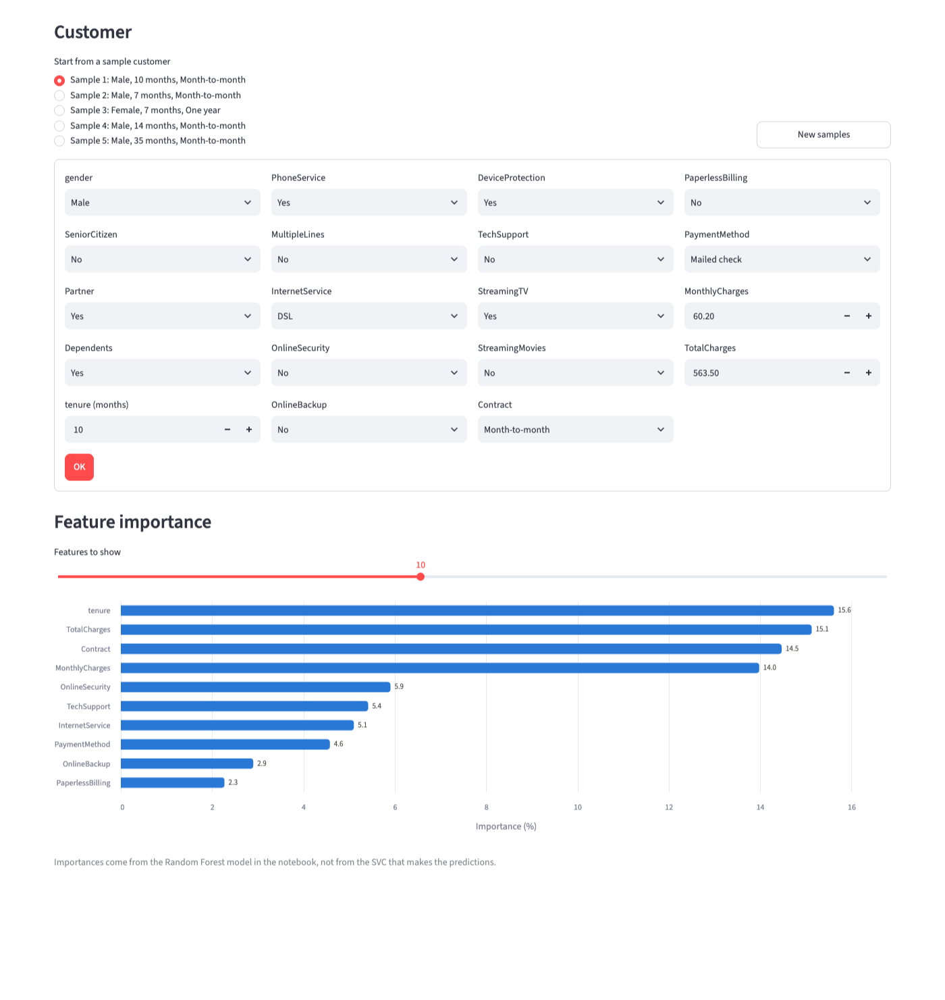

# Customer Churn Prediction

Predicts whether a telecom customer will churn, serves the model through a FastAPI service, and provides a Streamlit page for trying it out.



## What's in the repo

| Path | Purpose |
|---|---|
| `churn_train_v1.ipynb` | Training notebook: preprocessing pipeline, grid search, evaluation, saving the model |
| `churn_predict.ipynb` | Earlier exploration (label encoding, Random Forest and SVM baselines) |
| `FastAPI_main.py` | REST API that loads the saved model and serves predictions |
| `streamlit_app.py` | Web UI that calls the API |
| `data/dataset.csv` | Telco Customer Churn dataset (7,043 customers) |
| `models/best_churn_model.pkl` | Saved scikit-learn pipeline used by the API |
| `models/feature_importance.csv` | Feature importances shown in the UI |
| `models/x_test.csv`, `models/y_test.csv` | Held-out test split; the API serves sample customers from `x_test.csv` |

## Model

- **Data:** [Telco Customer Churn](https://www.kaggle.com/datasets/blastchar/telco-customer-churn) from IBM sample data, split 80/20 with stratification on the target.
- **Pipeline:** `StandardScaler` on the numeric columns and `OneHotEncoder` on the categorical columns, followed by the classifier.
- **Selection:** 5-fold `GridSearchCV` over Random Forest, SVM and logistic regression candidates. The winner was an SVC with an RBF kernel and `C=1` (cross-validation accuracy 0.80).
- **Feature importance:** taken from a separately tuned Random Forest pipeline, because an RBF SVC has no importances of its own.

Results on the 1,407-row test set:


## Setup

Requires Python 3.13+ and [uv](https://docs.astral.sh/uv/).

```bash
git clone <repo-url>
cd churn_prediction
uv sync
```

## Run

Start the API, then the UI in a second terminal:

```bash
uv run uvicorn FastAPI_main:app --reload
uv run streamlit run streamlit_app.py
```

- API docs: http://127.0.0.1:8000/docs
- Streamlit app: http://localhost:8501

The UI expects the API at `http://127.0.0.1:8000`. Set `CHURN_API_URL` to point it elsewhere.

## API

| Method | Endpoint | Description |
|---|---|---|
| GET | `/health` | Service status and whether the model is loaded |
| POST | `/predict` | Prediction for one customer |
| POST | `/predict/batch` | Predictions for a list of customers |
| GET | `/sample-customers?n=5` | Random customers from the test set (1 to 100) |
| GET | `/feature-importance?top=10` | Top features by importance |

Example:

```bash
curl -s "http://127.0.0.1:8000/sample-customers?n=1" \
  | curl -s -X POST http://127.0.0.1:8000/predict/batch \
      -H "Content-Type: application/json" -d @-
```

```json
[{"churn": false, "score": -1.09}]
```

`score` is the SVC decision value, not a probability. Above 0 means churn, and values further from 0 are more confident.

## Notes

- The saved model was pickled with scikit-learn 1.7.2. Loading it with a newer version works but prints an `InconsistentVersionWarning`; re-run the notebook to re-save it under your installed version.
- The notebooks also need `matplotlib` and `seaborn`, which are not in `pyproject.toml`. Install them with `uv add --dev matplotlib seaborn ipykernel` before re-running.
